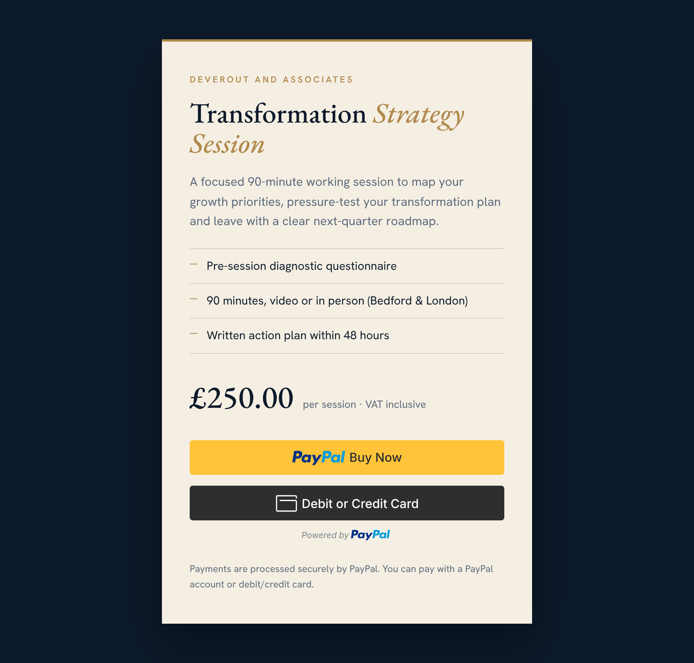

# PayPal Buy Button — Deverout and Associates

[](https://codespaces.new/deuerout/stunning-blini-3031f8?devcontainer_path=.devcontainer%2Fpaypal-buy-button%2Fdevcontainer.json)

Open the code in the web IDE now using GitHub Codespaces — the button above starts the server and opens a live preview.

A "Buy Now" checkout for a **Transformation Strategy Session (£250)** using the PayPal JavaScript SDK. Orders are created and captured on the server, so the price and API secret never reach the browser. No npm dependencies.

## Preview



## Getting started

### 1. Get sandbox credentials
1. Sign in at [developer.paypal.com](https://developer.paypal.com/dashboard/applications/sandbox).
2. **Apps & Credentials → Sandbox → Create App**.
3. Copy the **Client ID** and **Secret**.

### 2a. Run in Codespaces
1. Add `PAYPAL_CLIENT_ID` and `PAYPAL_CLIENT_SECRET` as [Codespaces secrets](https://github.com/settings/codespaces) for this repository (or paste them into `.env` once the codespace opens).
2. Click **Open in GitHub Codespaces**. The server starts on port 8888 and the preview opens automatically.

### 2b. Run locally
```bash
cd paypal-buy-button
cp .env.example .env      # add your Client ID and Secret
npm start                 # http://localhost:8888
```
Requires Node 18+.

### 3. Test a payment
Click **Buy Now** and sign in with a **sandbox personal account** (Developer Dashboard → Testing Tools → Sandbox Accounts), or use **Debit or Credit Card** with a [test card number](https://developer.paypal.com/tools/sandbox/card-testing/).

## How it works

| Step | Browser (`public/app.js`) | Server (`server.js`) |
|---|---|---|
| Load | `GET /api/config` → loads PayPal SDK with the Client ID | Returns Client ID and catalogue |
| Click | `createOrder()` → `POST /api/orders` | `POST /v2/checkout/orders` with server-side price |
| Approve | `onApprove()` → `POST /api/orders/:id/capture` | `POST /v2/checkout/orders/:id/capture` |
| Result | Shows confirmation, or restarts on `INSTRUMENT_DECLINED` | Returns PayPal response |

To change the product or price, edit `PRODUCTS` in `server.js`.

## Going live
1. Create a **Live** app in the PayPal Developer Dashboard.
2. Set `PAYPAL_ENV=live` with the live Client ID and Secret.
3. Host `server.js` on a Node platform (Render, Railway, Fly.io, Azure App Service). The main deuerout.com site on Netlify is static, so link its "Book a session" button to the hosted checkout URL.
